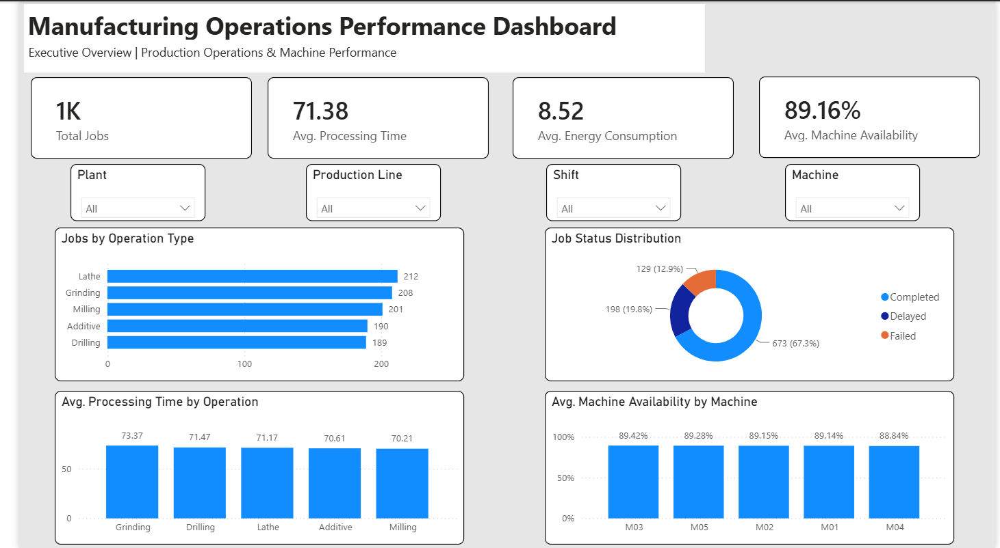
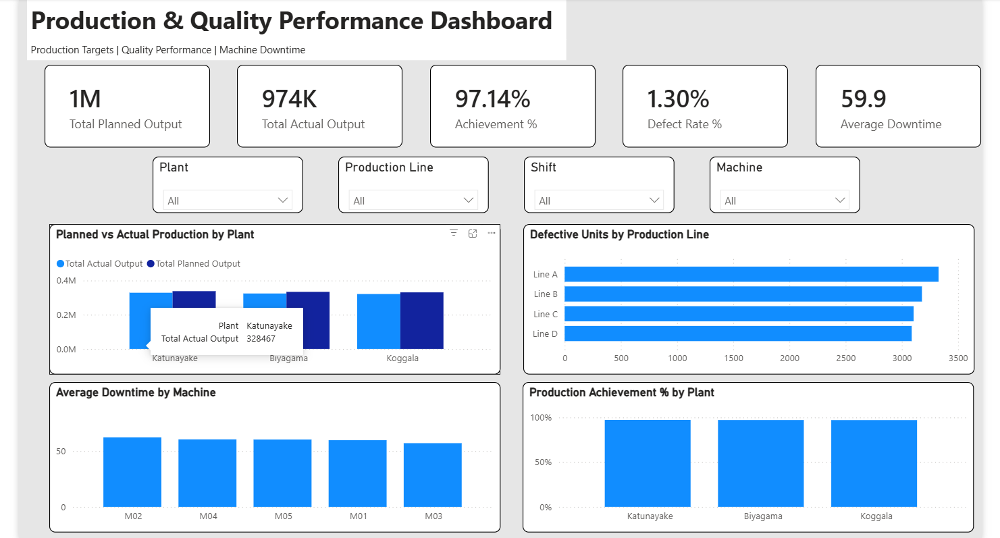

# Manufacturing Operations & Quality Performance Dashboard

### Power BI | Manufacturing Analytics | Business Intelligence

## Project Overview

This project presents an interactive, two-page Power BI dashboard designed to monitor manufacturing operations, production efficiency, quality performance, and machine availability.

The dashboard demonstrates how manufacturing data can be transformed into meaningful operational insights to support performance monitoring and data-driven decision-making.

**Data Source:** Public manufacturing dataset supplemented with simulated production and quality data for educational and portfolio purposes.

## Tools & Technologies

- Microsoft Power BI
- Microsoft Excel
- Power Query
- DAX (Data Analysis Expressions)
- Data Cleaning & Transformation
- KPI Reporting & Data Visualization

## Dashboard 1: Manufacturing Operations Overview

**Key Performance Indicators:**
- Total Jobs
- Average Processing Time
- Average Energy Consumption
- Average Machine Availability

**Visualizations:**
- Jobs by Operation Type
- Job Status Distribution
- Average Processing Time by Operation
- Average Machine Availability by Machine

## Dashboard 2: Production & Quality Analysis

**Key Performance Indicators:**
- Total Planned Output
- Total Actual Output
- Production Achievement %
- Defect Rate %
- Average Downtime

**Visualizations:**
- Planned vs Actual Production by Plant
- Defective Units by Production Line
- Average Downtime by Machine
- Production Achievement % by Plant

## Interactive Features

Both dashboard pages include dynamic slicers for:

- Plant
- Production Line
- Shift
- Machine

These enable users to explore operational performance across different manufacturing dimensions.

## Key Findings

Based on the sample dataset:

- Overall production achievement was approximately **97.14%**, indicating actual production was around 2.86% below planned output.
- The overall defect rate was approximately **1.30%**.
- Average machine availability was approximately **89.16%**.
- Job status analysis showed approximately **67.3% completed**, **19.8% delayed**, and **12.9% failed**.

*These findings describe the sample dataset and should not be interpreted as actual company performance.*

## Project Files

- `Manufacturing_Operations_Dashboard.pbix` — Interactive Power BI report
- `screenshots/Manufacturing_Overview.png` — Dashboard Page 1
- `screenshots/Production_Quality_Analysis.png` — Dashboard Page 2

## Skills Demonstrated

Business Intelligence | Data Analysis | Data Visualization | DAX | KPI Development | Manufacturing Analytics | Business Analysis

## Disclaimer

This is an independent portfolio project created using public and simulated data. It does not contain confidential company information or represent an official company dashboard.
